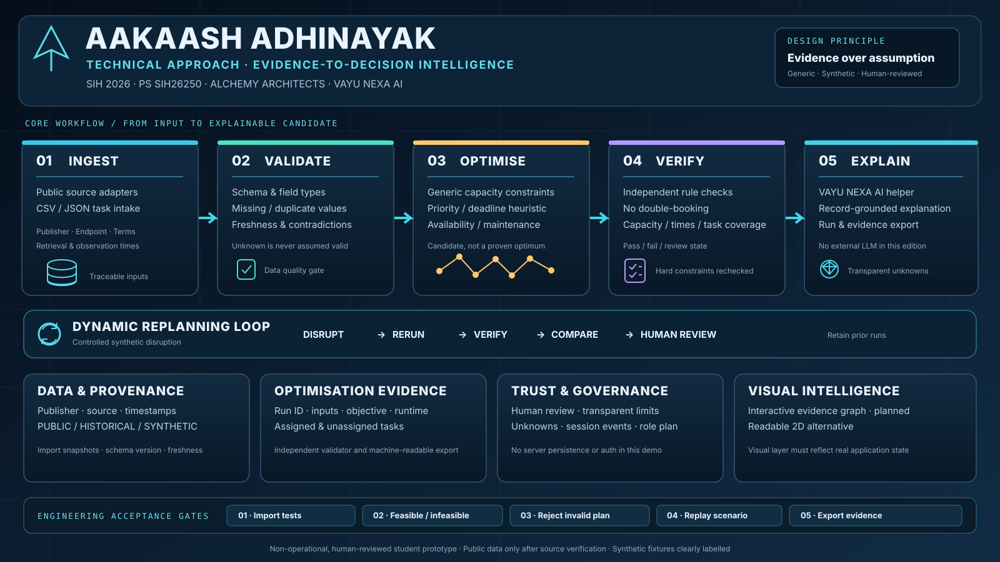

<div align="center">
  
  <h1>AAKAASH ADHINAYAK</h1>
  <p><strong>Evidence-to-Decision Intelligence for Resource Planning</strong></p>
  <p>Smart India Hackathon 2026 · SIH26250 · Alchemy Architects</p>
  <p><a href="https://aakaash-adhinayak.ai.studio/">Open hosted Google AI Studio app ↗</a></p>
</div>

## Overview
AAKAASH ADHINAYAK is a student research prototype exploring traceable generic resource planning: structured inputs, data-quality checks, deterministic allocation, independent validation, scenario replay and evidence-led explanations. The embedded assistant concept is named **VAYU NEXA AI**.

This curated repository edition uses generic, explicitly synthetic examples. It is not a live aircraft/defence command system and is not approved by or connected to the Ministry of Defence.

## Core workflow
`IMPORT → VALIDATE → NORMALISE → OPTIMISE → INDEPENDENTLY VERIFY → EXPLAIN → REPLAN → AUDIT → EXPORT EVIDENCE`

## Included in the current demo
- React + TypeScript responsive dark analytics interface.
- Deterministic heuristic planner for generic capacity, capability, availability, deadlines, maintenance and overlap constraints.
- Independent validation of generated assignments.
- CSV/JSON task intake with schema/value checks.
- Controlled generic resource-outage replay.
- JSON exports and browser-session event history.
- Local rule-based VAYU NEXA helper grounded in current application state.
- Research and design documentation.

## Android app download

The native React Native / Expo project lives in [`mobile-native/`](mobile-native/). Every successful Android build is packaged into a GitHub Release with:
- `AAKAASH-ADHINAYAK.apk` — debug-signed APK for Android sideload/testing.
- `AAKAASH_ADHINAYAK_NATIVE_MOBILE_SOURCE.zip` — mobile source archive.
- `AAKAASH_ADHINAYAK_APK_BUILD_KIT.zip` — source plus GitHub Actions build workflow and instructions.
- `SHA256SUMS.txt` — SHA-256 checksums for file integrity.

Open the [Releases page](https://github.com/Aasidh0224/Alchemy-Architects-AAKAASH-ADHINAYAK/releases) and download the latest **AAKAASH ADHINAYAK Android Test Build**. Releases are debug-signed test builds, not production Play Store packages. Because this repository is private, GitHub access is required to retrieve its assets.

The native app is a curated companion using generic synthetic data. It is not a one-to-one implementation of every hosted website feature, and it is not connected to operational services.

## Run locally
Requires Node.js 20+ and npm.

```bash
npm install
npm run dev
```

Checks:
```bash
npm test
npm run build
```

No API keys are required for the root demo. Never commit real secrets or populated environment files.

## Install on a phone (PWA)

This curated demo is an installable Progressive Web App. After deployment over HTTPS, it can be added to an Android or iPhone home screen. This workflow does not produce an APK or app-store listing.

### Android
Open the HTTPS deployment in Chrome. Tap **Install app** in the header, or open Chrome's menu and choose **Install app** / **Add to Home screen**.

### iPhone / iPad
Open the HTTPS deployment in Safari. Tap **Share** → **Add to Home Screen** → **Add**.

### Offline behaviour
The service worker caches the application shell and static same-origin resources. It intentionally does not cache API responses. The generic demo planner can be opened offline after the app shell has been cached; server-side features require connectivity.

### Important deployment note
Adding PWA files to this repository does not modify the separate Google AI Studio deployment automatically. Deploy this repository to an HTTPS host first, then install that deployed URL.

PWA assets are in `public/manifest.webmanifest`, `public/sw.js`, `public/icons/`, and the install component in `src/components/InstallAppButton.tsx`. See [mobile installation guide](MOBILE_INSTALL_GUIDE.md).

## Judge walkthrough
1. Inspect the synthetic-data label in Command Centre.
2. Run the planner and inspect assigned/unassigned tasks.
3. Review independent validation checks.
4. Simulate a synthetic outage and compare the new run.
5. Import a CSV/JSON task file.
6. Export the run and evidence ledger.
7. Ask VAYU NEXA about constraints, unassigned tasks or source provenance.

## Project reports
- [Technical approach](docs/TECHNICAL_APPROACH.md)
- [Feasibility](docs/FEASIBILITY.md)
- [Viability](docs/VIABILITY.md)
- [Impact and benefits](docs/IMPACT_AND_BENEFITS.md)
- [Revenue model](docs/REVENUE_MODEL.md)
- [References and research](docs/REFERENCES_AND_RESEARCH.md)
- [35-area requirements roadmap](docs/35_AREA_ROADMAP.md)
- [Responsible scope and limitations](docs/REPOSITORY_SCOPE.md)

## Google AI Studio export files (sanitised)
The `ai-studio-export/` folder preserves the submitted package/build configuration, Bun lockfile, metadata, and generic server scaffold. The uploaded Firebase config's actual project identifiers and API key were replaced by placeholders. Firestore rules were tightened because the original rules allowed overly broad access. The original server's operational/weapon-related endpoints and unverified hard-coded fallback claims were not committed unchanged.

The folder is a sanitised configuration snapshot, not a byte-for-byte mirror of the hosted app. The root folder remains the current curated runnable demo.

## Evidence and limitations
- Seeded records are synthetic, not operational or public-live data.
- No verified public-data connector, external LLM, server database, server-enforced authentication or durable audit storage is configured in the root demo.
- The planner is a small heuristic, not a certified or globally optimal solver.
- The local assistant is rules-based; it is not a connected generative model.
- Metrics describe current demo inputs and measured run results. No universal accuracy, savings, speed or impact claim is made.
- See the Markdown reports and roadmap for implemented functionality versus future work.

## Responsible scope
This curated edition excludes live military asset/personnel readiness, weapon/payload selection, targeting, tactical combat routing, threat evasion, autonomous combat control and restricted defence-system integrations. Generic fixtures must never be described as genuine operational records.

## Contribution and security
See [CONTRIBUTING.md](CONTRIBUTING.md) and [SECURITY.md](SECURITY.md). Keep data provenance explicit, add tests for planning/validation changes, and never commit keys or sensitive records.

**Evidence over assumption. Human review before real-world action.**
